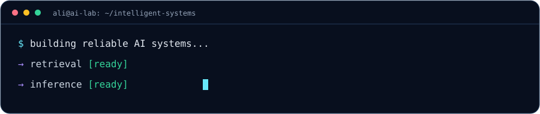

### Building intelligent systems for real-world impact.
*AI Engineer · Solution Architect · Applied AI Researcher*

---

## 01 / About

I work at the intersection of **Artificial Intelligence, software engineering, and data infrastructure**. My focus is translating modern AI research into dependable systems that solve practical problems.

- **Generative AI:** LLM applications, RAG pipelines, embeddings, and AI agents.
- **Language Technology:** NLP, document intelligence, and Indonesian/Acehnese language applications.
- **Public-Sector Technology:** GovTech, digital public services, and responsible AI adoption.
- **Platform Engineering:** APIs, backend systems, deployment, and scalable data platforms.

Based in **Aceh, Indonesia** · Interested in applied research and engineering collaboration.

## 02 / Engineering Stack

| Domain | Focus areas |
|---|---|
| AI / ML | LLMs, NLP, embeddings, inference, model evaluation |
| Knowledge systems | RAG, vector search, document processing, knowledge bases |
| Backend | Python, FastAPI, Laravel, REST APIs |
| Data | PostgreSQL, MySQL, data pipelines, analytics |
| Infrastructure | Linux, Docker, virtualization, deployment |

## 03 / Selected Work

| Project | Engineering focus |
|---|---|
| [AcehX](https://github.com/alibungker/AcehX) | AI and knowledge-system exploration |
| [RAG Project Class](https://github.com/alibungker/rag-projectClass) | Retrieval-augmented generation prototype |
| [Acehnese Spell Correction](https://github.com/alibungker/spell-correction-aceh) | NLP and local-language text processing |
| [E-Risalah](https://github.com/alibungker/risalah) | Meeting and document workflow platform |
| [Meetily](https://github.com/alibungker/meetily) | AI meeting assistant exploration |
| [DeepSeek OCR App](https://github.com/alibungker/deepseek_ocr_app) | OCR and document intelligence exploration |
| [AI Photobooth](https://github.com/alibungker/AI-photobooth) | Applied computer-vision application |
| [OpenFamily](https://github.com/alibungker/OpenFamily) | Open-source application exploration |

## 04 / Current Interests

- Reliable RAG: retrieval evaluation, reranking, chunking, and grounded generation.
- Efficient inference: quantization, model serving, and GPU utilization.
- Local-language AI: Indonesian and Acehnese NLP resources.
- AI for public services: explainability, privacy, governance, and measurable impact.
- Geospatial and disaster intelligence: data-driven decision support.

## 05 / GitHub Activity

## 06 / Engineering Notes

---

**Let's build useful technology.**

[GitHub Repositories](https://github.com/alibungker?tab=repositories) · [GitHub Profile](https://github.com/alibungker)

Designed with a dark-tech aesthetic · Built in Aceh, Indonesia

